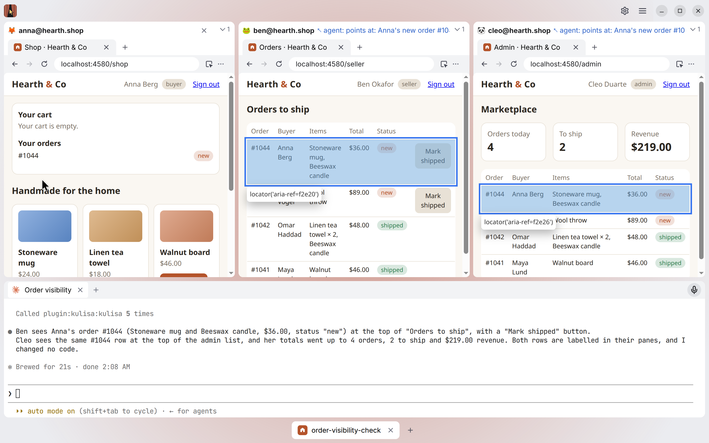

# Kulisa



**Kulisa is the home where your AI agent works on the web. In every role and account it needs, until everything
works. Watch every step, or take a break.**

A free desktop app for Windows and Linux (macOS is coming). The AI agent you choose (Claude Code or Codex) works in
your signed-in browser profiles side by side, as every user of your app: it builds, checks the result as the buyer,
the seller and the admin, fixes, and goes again until it works. Made first for developing web apps with several users
at once, and good for any work in web apps: several clients' accounts, admin and support work.

- **A profile for each person.** Each profile is a browser of its own, as in Chrome: its sign-ins, cookies and tabs.
  You sign in once, by hand, never the agent; every task has that sign-in, and it lasts across restarts.
- **An agent you can watch.** It runs in a terminal inside the window and drives the profiles through Kulisa's MCP
  server. Every click and keystroke it makes is marked on the page.
- **Point and tell.** Click Pick, then the thing on the page: an exact reference to it lands in the agent's prompt,
  and you write the rest.
- **Several tasks at once.** Each task is one piece of work: its own agent, its own branch of the code, and the
  project's profiles, still signed in.
- **Yours, on your computer.** No account and no cloud of Kulisa's own.

**[Download](https://github.com/cosmotools/kulisa/releases/latest)** · **[Website](https://kulisa.app)** ·
**[User guide](https://kulisa.app/docs)**

## Why

Kulisa brings coding and testing as several signed-in users into one window: buyer, seller and admin, or client
accounts for support work. The human watches the agent's actions and can intervene.

The name comes from Russian *кулиса*, the wings of a theatre stage: the agent directs, profiles act, and the human
watches from the audience.

## Documentation

- [User guide](https://kulisa.app/docs), also [docs/guide.md](docs/guide.md).
- [AGENTS.md](AGENTS.md): development rules and links to architecture docs.
- [Testing](docs/testing.md), [contributing](CONTRIBUTING.md), [licensing](docs/LICENSING.md).
- [GitHub issues](https://github.com/cosmotools/kulisa/issues): plans and bugs.

## Run

Requirements: Node 24.12+ (the code runs from source by its type stripping), npm 11, git. Linux: a compiler
(`npm install` builds `node-pty` for Electron; macOS and Windows load its prebuilt binary), `sudo apt install xvfb
openbox` for the tests on a screen of their own, `rpm` for the `.rpm`. Windows: the Microsoft Visual C++
Redistributable (`winget install Microsoft.VCRedist.2015+.x64`), which Electron's download and knip load. npm 11 runs
a dependency's install script only when `allowScripts` in package.json lists it (`npm install-scripts approve <pkg>`);
approving `node-pty` builds it for Node: `npm run postinstall` after that builds it for Electron.

```sh
npm install           # the dependencies; node-pty built for Electron on Linux (scripts/postinstall.ts)
npm start             # builds the window, then opens the windows and tasks open last; at first start the welcome, then New Project
npm run build         # type checks (tsc), then the window built by Vite into dist/renderer
npm run watch         # the window built again on every change; reload it (Ctrl+R in its DevTools) or restart
npm test              # unit tests, knip, ESLint, actionlint (when installed), then the e2e tests on Playwright Test,
                      # the real app against a local test site (docs/testing.md)
npm run test:unit     # the unit tests alone, plain Node, a few seconds
npm run test:visible  # the e2e tests on your screen, to watch them
npm run lint          # ESLint (docs/testing.md, Lint), then npm run deps
npm run deps          # dependency-cruiser: no import against the layers, no cycle (docs/testing.md, Layers)
npm run knip          # no file, export or dependency that nothing uses (docs/testing.md, Dead code)
npm run package       # the app for this platform, in out/
npm run make          # installers for this platform, in out/make/ (.deb and .rpm, .exe, .dmg and .zip)
npm run publish       # the same, into a draft release on GitHub (GITHUB_TOKEN); the CI does it on a merge into main
npm run icons         # after changing assets/icon.svg: icon.png, .ico, .icns next to it (committed)
npm version <patch|minor> --no-git-tag-version   # a release's version (AGENTS.md, Releases); the plugin manifest's follows (scripts/version.ts)
```

Kulisa's tests run on Ubuntu, Windows and macOS at every pull request; macOS is for development so far (from source,
or built unsigned on one's own Mac); Windows is less tried by hand (#194). Installers are built by
[Electron Forge](https://www.electronforge.io/) (`forge.config.ts`), each on its own platform ([releases.md](docs/releases.md)). On Linux `npm start`
and `npm test` run Electron with `--no-sandbox` (`chrome-sandbox` in `node_modules` is not setuid); the `.deb` installs
it setuid, so the installed app is sandboxed.

Kulisa keeps its data (projects, profiles with their sign-ins, settings) in `~/.config/Kulisa` on Linux,
`~/Library/Application Support/Kulisa` on macOS, `%APPDATA%\Kulisa` on Windows (docs/tasks.md, What is on the
computer).

| Variable | Effect |
|---|---|
| `KULISA_PROJECT` | The project in this folder (added if new): its task shown last opened, or a new one |
| `KULISA_AGENT` | One agent command for every task, without asking (e.g. a CLI Kulisa does not know). It gets no Claude Code plugin; its environment has its task's MCP URL as `KULISA_MCP_URL`, with `KULISA_URL` and `KULISA_TASK` |
| `KULISA_SIGNIN_HOSTS` | More sign-in hosts for the automatic sign-in pause, comma-separated |
| `KULISA_DATA` | Data folder instead of the one above (e.g. to try a build next to your real one: one Kulisa runs per data folder, a second on the same one shows the first's window) |
| `KULISA_MCP_PORT` | MCP server port (default 4450; `0` picks a free one) |
| `KULISA_QUIT` | Only ask the Kulisa running on the same data folder to quit, its tabs and sign-ins saved as at SIGINT, which Windows does not have (`npm start`'s Ctrl+C there; `run-kulisa`'s `kulisa.sh stop`) |
| `KULISA_GITHUB` | GitHub's address instead of github.com, its API under `/api` (the tests' own: their fake GitHub; src/github) |
| `KULISA_SHOT` | Save a screenshot of the whole window to this PNG file ~4 s after start (`KULISA_SHOT_DELAY`, ms) |

### Developing with an agent

Start with [AGENTS.md](AGENTS.md): the shared rules for Codex and Claude Code, including worktrees and pull requests.
Each directory's `AGENTS.md` holds its local rules; `CLAUDE.md` imports the adjacent file for Claude Code.
Development skills live in `.agents/skills/`, with Claude Code entrypoints in `.claude/skills/`.
Run `npx skills experimental_install` from the checkout root to restore third-party skills from `skills-lock.json`.
For Claude Code, run `npx skills add pierrecomputer/pierre --skill diffs trees --agent claude-code` to create its skill links.
[Testing](docs/testing.md) describes the test harness, code analysis and Claude Code's optional LSP setup and lint hook.

## Code

| Folder | Responsibility |
|---|---|
| `src/main/`, `src/preload/` | Electron core and window bridge |
| `src/renderer/` | React window, built by Vite into `dist/renderer` |
| `src/shared/` | Shared types, channel contracts and helpers |
| `src/<package>/` | Self-contained capabilities; [catalog](docs/packages.md#the-kulisa-packages) |
| `test/` | Unit/e2e tests and local test site |
| `scripts/` | Development launch, native dependency rebuilds, icons and version synchronization |
| `assets/` | App icon and installer assets |
| `docs/` | Architecture and user documentation |
| `.agents/`, `.claude/` | Shared development skills and Claude entrypoints/hooks/plugin |
| `.github/workflows/` | Checks and releases |

Build/tool configuration lives at the root. Each part's documentation maps code by responsibility.

## License

Kulisa is free software: Copyright (C) 2026 Orudzhali Nagaev, licensed under the GNU General Public License,
version 3 or (at your option) any later version ([LICENSE](LICENSE)). It comes with no warranty.

- **Free.** Kulisa is free to use, at home and at work, and the app on your computer stays free. You pay only for
  the agent you choose (Claude Code, Codex). Paid services may come one day, only for what costs money to run
  (a cloud service), never for what runs on your computer.
- **Forks** are welcome: you may change Kulisa, share it and even charge for copies, but whoever gets your version
  gets its source under the same license, free to share on. No one can close the code.
- **The name and the logo** are not covered by the license: a fork must be called otherwise and not look like the
  official Kulisa.

What the license covers and what it does not (agents, their plugins, MCP servers, services):
[docs/LICENSING.md](docs/LICENSING.md). Contributing: [CONTRIBUTING.md](CONTRIBUTING.md).
