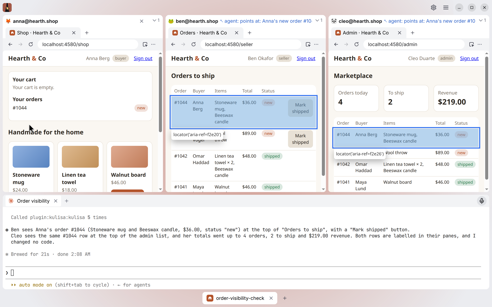

# Kulisa user guide

Kulisa is a desktop app where the AI agent you choose (Claude Code, Codex) works in your signed-in browser profiles,
side by side. It builds, checks the result as every user of your app, fixes, and goes again until it works, while you
watch every step or take a break. It is made first for developing web apps with several users at once (a buyer, a
seller, an admin), and is good for any work in web apps: several clients' accounts, admin and support work.

You sign in to your accounts yourself, by hand; the agent never does. Everything stays on your computer.

## Words used here

- **Profile**: one browser identity, as in Chrome: its own cookies, sign-ins and tabs. One profile is one user of
  your app ("ann, the seller"). It is shown as a pane with its tabs.
- **Project**: what you work on: its code (a folder, or one or more git repositories), the agents that work in it,
  and its profiles. A project is not opened or closed itself; its tasks are.
- **Task**: one piece of work in a project: an agent in a terminal, its own copy of the code, the project's profiles,
  and a grid of panes. Several tasks of one project run at once, each building something else.
- **Group**: a project's open tasks in the bar at the bottom of the window, as a tab group in Chrome.

## Getting started

Kulisa has no installers yet: it runs from its source code (see the
[README](https://github.com/cosmotools/kulisa#readme)). It is tested on Linux (Ubuntu) so far; macOS and Windows are
to come.

1. **Make a project.** At the first start New Project opens by itself. Choose where its code comes from (below), give
   it a name, Create. Settings opens on the new project's page.
2. **Choose its agent.** On the project's page, under Agents, **+** → New Account → Claude Code (or Codex). Kulisa
   starts the agent's own sign-in, which opens your browser; sign in there, with the account you mean. If the agent is not installed
   yet, install it first in **Settings → Agents** (Install: Kulisa runs its maker's installer for you).
3. **Make a profile** for each user of your app: on the project's page, under Profiles, **+** → New Profile…, a name
   (`ann@shop.com`). Say in **Settings → Profiles** who it is ("seller; can approve refunds"): the agent chooses
   profiles by it.
4. **Make a task**: **+** in the bar at the bottom, then your project. The agent starts in a terminal; tell it what to
   do. It opens the profiles it needs itself.
5. **Sign in** where your app needs a real account: when the agent asks, or ahead of time with **Sign In…** in
   Settings → Profiles. You sign in once, for every task.

## The window

- **The title bar**: the Kulisa logo in the shown project's color, **Settings** (the gear), and **☰**, the window's
  menu: zoom, theme, where the tasks' bar is, Arrange panels, Agents…, Keyboard Shortcuts, links, Exit.
- **The grid**: the shown task's panes (one per open profile) and its terminals. Drag a pane by its header to move it,
  onto another pane to stack them as tabs; drag the gaps to resize. **☰ → Arrange panels** offers ready-made
  arrangements. Each task keeps its own grid.
- **The tasks' bar**, under the grid (or over it: **☰ → Tasks bar**): a group per project with open tasks, each task a
  tab with its agent's state, and **+** after them.
- **No task open** (at the first start, or after you close the last group): the window shows New Task and New
  Project….

## Projects

### New Project

Its code first, on the left:

- **New folder**: a new, empty project. Kulisa makes the folder (in `~/Kulisa` unless you choose another place) and,
  with Create Git repository on, a git repository in it, so tasks can have copies of their own.
- **Folders on disk**: code you already have, one folder or several (a frontend and a backend). Nothing in them is
  changed.
- **Clone from URL**: one repository or several, cloned with your own git (its keys and credentials).

The dialog says what will happen as you type. Its color and icon are chosen for you (its site's favicon, when its code
has one); change them on its page.

### A project's page

**Settings** (the gear) → **Projects** → the project, or **Project Settings…** in a group's right-click menu.
Everything is saved as you change it; there is no Save button.

- **Name**, and beside it its **color and icon**: one of Kulisa's, a picture file of yours, or its site's favicon.
- **Code**: its repositories or folders. **+** adds one (Add Folder…, Clone from URL…), **−** removes the selected
  one from the project (its folder stays), **★** makes it the default: the agent starts there.
- **Agents**: the accounts its tasks run. The first is the default, the one a new task runs; none: tasks start with a
  terminal only, where you run any program yourself.
- **Profiles**: which profiles its tasks have. **+** makes a new one or adds one you have; **−** lets go of one (the
  profile stays in Settings → Profiles).
- **Local addresses**: addresses of your app besides `localhost` (a tunnel, a dev domain), where the agent may type a
  test user's password (Profiles, below).
- **⋯ → Delete Project…** deletes Kulisa's data of the project and all its tasks, after a question saying what goes.
  Its own folder and your code stay.

## Agents and their accounts

**Settings → Agents** (or **☰ → Agents…**) lists the agents Kulisa knows (Claude Code, Codex): installed or not. Click
one to see its version, its accounts, and **Install** if it is not installed. Kulisa never removes or updates an agent: its maker's installer updates it.

An **account** is an agent signed in to one of your subscriptions, so a work and a personal one can run side by side.
Make one with the **+** beside Agents (then the agent), the **+** over its accounts on the agent's page, or on a
project's page. Each account starts clean: your own settings of the
agent outside Kulisa are not used. It is shown by its email, and stays until you delete it here (**−**).

A task keeps the agent it started with. **Change agent…** in the terminal's right-click menu picks another of the
project's accounts, and the work goes on: when one runs out of its limit, continue with another. Another account of
the same agent continues the same conversation; another agent (Codex after Claude Code) first reads what was said and
done in the task, then tells you in a few lines where it stands. **New Conversation** in the same menu starts the
agent over, from nothing.

**Dictation**, where the agent has its own (Claude Code with a Claude.ai account): the microphone in the terminal's
header. Hold it while you speak, or click to start and click again to stop. The text goes into the agent's input for
you to read and send. Its language is next to it.

## Tasks

- **A new task**: **+** in the tasks' bar, then a project (or Ctrl+Shift+N for the shown project). It runs the
  project's default agent with a new conversation; describe the task to it. Its profiles are all closed: the agent
  opens those it needs, or you do (right-click the task's tab).
- **Its own copy of the code.** In a project with git, every task works in a copy of its own (a git worktree) on a
  branch of its own, next to your project's folder (`myshop@task-2`). Your project's folder stays yours: the agent
  merges its work into it only when you ask (and checks first that you have no unsaved changes there), or opens a pull
  request. Files git ignores, such as `.env`, are copied into the task's copy too. Without git, tasks work right in
  the project's folder.
- **Its own ports.** Each task runs your app on its own ports, the usual ones plus 100, 200, …, so several tasks run
  the app at once. Its profiles' tabs on local addresses already point there, and stay signed in.
- **Its name** is `task-1`, `task-2` … until the agent names it, once it knows what the task is about, or you do
  (**Rename…** in its tab's right-click menu). The branch takes the name too.
- **Its state** on its tab: working (sparkles), waiting for you (a bell: a question, a permission, a limit), done (a
  check, until you look at the task).
- **Switch** by clicking a tab, of any group. The other tasks keep running: their agents and pages go on.
- **× closes a task**: its agent stops and its tabs close; its code, branch, profiles and conversation stay. Open it
  again from **+** (under its project) or its group's right-click menu: the agent continues the conversation.
- **Delete Task…** (its tab's right-click menu) deletes it for good: its copy of the code, its branch, its profiles'
  copies, its conversation. The question says what would be lost (work not merged and not pushed). Once a closed
  task's work is merged, its group's menu marks it "merged" and offers **Delete Merged Tasks…**.

### Groups

- A click on a group's name folds it to its name, and back.
- Its right-click menu: New Task, its closed tasks, Move to New Window, Move to Window, Project Settings…, Show Data
  Folder, Close Group.
- **Close Group** (or the middle button on its name, or × on its last task) closes all its tasks. It asks only when an
  agent is working.
- **Several windows**: Move to New Window, or drag a group's name out of the window, e.g. to a second monitor. Its
  agents and pages move along, still running.
- Closing Kulisa keeps everything: the windows, their groups and tasks come back at the next start.

## Profiles

**Settings → Profiles** is the one place for who a profile is: the same person in every project and task. Click a
profile under Profiles to see its page.

- The **+** beside Profiles makes one: type its name, Enter (or + → New Profile… on a project's page, to make it in
  that project).
- **Name**: letters, digits and `@ . _ + -`, so it can be the account's email (`ann+test@shop.com`).
- **About**: who it is in your app and what it can do. The agent picks profiles by it; if it is empty, the agent
  asks you and saves your answer.
- **Picture**: an animal, to tell the panes apart at a glance.
- **⋯ → Delete Profile…** (or right-click the profile) removes it everywhere, with its sign-ins, for good.

### Signing in

- **You sign in once, for every task.** Each profile has a master copy: **Sign In…** in Settings → Profiles, or
  **Sign In to Master…** in its pane's right-click menu, opens it in a window of its own. Sign in there; every task gets
  that sign-in. A sign-in, or a sign-out, of a real account in any task reaches the others too.
- Signing in to your app on `localhost` stays in that task: each task runs its own copy of your app.
- **Refresh from Master…** (the pane's right-click menu) gives a task's profile the master's sign-ins again.
- **Test users of your app**: a profile's **Test login** and **Test password** (Settings → Profiles), or saved by the
  agent after it signs a user up. The agent then signs in as that user itself; Kulisa types the password, the agent
  never sees it, and only on your local app, never on a real site or an account provider (Google, Microsoft …).
- While a pane is on a sign-in page (Microsoft, Google, Okta …), the agent is kept out of that profile until you are
  through.

### Open, close, remove

- **×** on a pane closes the profile: its tabs go and free their memory; it stays signed in. Open it again from the
  task tab's right-click menu, with the same tabs.
- **Remove from Project…** (the pane's right-click menu) takes the profile out of this project; it stays in Settings →
  Profiles.

## A profile's pane

A pane is a small Chrome: a tab strip, an address bar, back, forward and reload.

- `target=_blank` links and pop-ups open as tabs of the same profile. Right-click a tab: Reload, Duplicate, Close tab,
  Close other tabs.
- Chrome's keys work in a page: Ctrl+T, Ctrl+W, Ctrl+Shift+T, Ctrl+L, Ctrl+Tab, Ctrl+1…9 (Keyboard shortcuts, below).
- **Zoom** a site with Ctrl + / − / 0 in its page; it is kept for that site in that profile and shown in the address
  bar (a click resets it).
- **DevTools** of a tab: the pane's ⋮ menu, or F12.
- A page's alert or confirm shows in its pane, as in Chrome. A page that does not load says why, as Chrome's error
  page does.

## Working with the agent

- **You see what it does.** Each of its actions is marked in the page (where it clicks, the element outlined, its own
  pointer), and a caption over the pane says what it is doing.
- **Point and tell.** Click **Pick** (the arrow icon at the end of the address bar, or Ctrl+Shift+C), then an element
  on the page. A reference to it goes into the agent's input; write the rest of the message around it ("this button
  does nothing") and send. Picks from several panes can go into one message. Esc cancels.
- **It points back.** Asked where something is, the agent outlines it in the page, with a label over the pane, until
  you click or type there.
- **Several users at once**: the agent acts as one profile and checks the effect as another ("Sam sends an invite,
  Ann receives it").
- **Its other terminals.** What keeps running (your app's dev server, `docker compose up`) the agent starts in a
  terminal of its own next to its own, so you see it, stop it and type into it.

## Terminals

- The agent's terminal is your own shell in the task's folder, with the agent started in it, as if you had typed it:
  your project's environment applies.
- **+** in its header opens another shell there. Terminals come back after a restart, each a fresh shell in its place;
  **×** or `exit` closes one.
- Copy and paste as in your OS's terminal: Ctrl+Shift+C / Ctrl+Shift+V on Linux, Ctrl+C / Ctrl+V on Windows, ⌘C / ⌘V
  on macOS.
- Ctrl+click a link to open it: Kulisa asks where, in one of the task's profiles or in your own browser.
- Right-click: Copy, Paste, Select all, Clear, and Change agent… and New Conversation in the agent's terminal.

## Look and zoom

- **☰ → Theme**: Dark, Light, or System (as your OS). Profiles' pages keep your OS's theme, so your app looks as its
  users see it.
- **Kulisa's zoom**: Ctrl + / − / 0 outside the pages, or the zoom row in ☰. It scales all of Kulisa, pages included;
  when not 100%, the title bar shows it (a click resets it).

## Keyboard shortcuts

**☰ → Keyboard Shortcuts** (Ctrl+Shift+/) lists them all. On macOS they are ⌘'s. The main ones:

| Keys | What |
|---|---|
| Ctrl+` | The agent's terminal, and back to the page |
| Ctrl+Shift+` | A new terminal |
| Ctrl+Shift+A | New task: of which project, or a closed one |
| Ctrl+Shift+N | New task of the shown project |
| Ctrl+Shift+1…9 | A task of the shown group |
| Ctrl+Shift+PgDn / PgUp | The next or previous task |
| Ctrl+Shift+C (in a page) | Pick an element for the agent |
| Ctrl+T, Ctrl+W, Ctrl+Shift+T (in a page) | New tab, close the tab, open the tab closed last |
| Ctrl+L (in a page) | The address bar |

In the terminal every other key is the agent's.

## Where Kulisa keeps things

- Your projects' folders hold only your code: Kulisa writes nothing there (except the first commit of a project it
  made).
- Tasks' copies of the code are next to the project's folder (`myshop@task-2`), or in `~/Kulisa/<project>@task-<n>`
  for a project of several repositories. They go when the task is deleted.
- Profiles, sign-ins, accounts and settings are in Kulisa's data folder: `~/.config/Kulisa` on Linux,
  `~/Library/Application Support/Kulisa` on macOS, `%APPDATA%\Kulisa` on Windows. Session cookies and test passwords
  are encrypted with your OS's keyring. **Show Data Folder** in a group's right-click menu opens a project's.
- Deleting a task, a profile or a project removes what Kulisa made for it.
