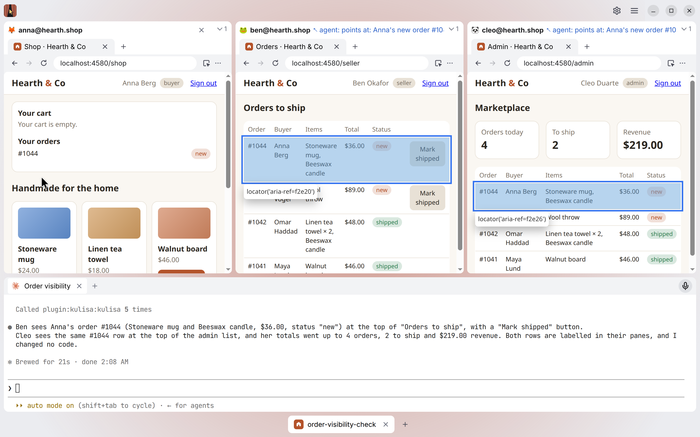

# Kulisa user guide

Kulisa is a desktop app where the coding agent you choose develops and checks web and command-line apps while
you watch and try the result together. The agent works in a terminal, opens browser profiles to test a web app as
its different users, and runs CLI apps in interactive terminals you can both operate. Several tasks let you work
on different parts of a project at once.

You sign in to your accounts yourself, by hand; the agent never does, except as test users of your own app on this
computer. Everything stays on your computer.

## Words used here

- **Profile**: one browser identity, as in Chrome: its own cookies, sign-ins and tabs. One profile is one user of
  your app ("ann, the seller"). It is shown as a pane with its tabs.
- **Project**: what you work on: its code (a folder, or one or more git repositories), the agents that work in it,
  and any browser profiles it needs. A project is not opened or closed itself; its tasks are.
- **Task**: one piece of work in a project: an agent in a terminal, a branch and copy of the code when needed,
  browser profiles and interactive terminals for checking the result. Several tasks of one project run at once, each building something else.
- **Tab**: an open task in the tasks' bar (under the grid, or in the title bar), as a browser's tab; its project's icon is on it.

## Systems

Kulisa is made for Linux, Windows and macOS. Its installers are for 64-bit Intel and AMD processors (x64), not yet
for ARM ones.

- **Linux:** Ubuntu, Debian and Fedora, in the versions their makers still support. Kulisa is made on Ubuntu, and
  tested there the most.
- **Windows:** Windows 10 and later. Newer there, and less tried.
- **macOS:** Ventura (13) and later. Tested by its developers, run from its code; no installer yet.

Not as an AppImage, Snap or Flatpak, on purpose: on recent Ubuntu an AppImage runs only with the browser's protection
of your signed-in pages turned off, and Snap and Flatpak would keep Kulisa from your terminal, git and agents, which it
works with.

## Getting started

Download Kulisa from its [latest release](https://github.com/cosmotools/kulisa/releases/latest):

- **Windows:** `Kulisa-<version>.Setup.exe`. It is not signed yet, so Windows warns about it: More info → Run anyway.
  It installs for you alone, with no questions, and starts. From then on it updates itself: a new version is
  downloaded in the background; Kulisa offers to restart into it, or it starts the next time you start Kulisa.
- **Linux:** the `.deb` for Ubuntu and Debian (`sudo apt install ./kulisa_<version>_amd64.deb`), the `.rpm` for
  Fedora. Kulisa is then in your apps. On Ubuntu and Debian it then updates with the system: a new version comes in
  Software Updater, or with `sudo apt update && sudo apt upgrade`; installed while Kulisa is open, it offers to restart
  (everything comes back as it was), or starts next time. The `.rpm` does not update itself: install a new
  version the same way.
- **macOS:** to come.

Every installer is built by GitHub from Kulisa's published code, and GitHub keeps a signed record of it. To check a
file you downloaded, with GitHub's command-line tool: `gh attestation verify <file> -R cosmotools/kulisa`.

1. **Make a project.** The welcome shows an animated shop example in Customer and Admin browser profiles: the
   red agent character scrolls, selects a product and places an order on the left, then moves to the administrator
   on the right to check it. The left browser keeps its result while the terminal shows a familiar coding CLI:
   your request, file edits, tool calls and their results. Choose your own CLI, such as Claude Code or Codex.
   On a wide window, a small character relaxes with coffee while the agent works.
   Use **Pause demonstration** to stop the animation. The **CLI app** example shows your agent building and trying a coding agent of your own:
   it launches in another terminal, receives a coding task, edits a file and checks the result. Then choose **Create a project**.
   Connect an agent, choose where the code comes from and finish the project setup. **Create project** opens its first task.
   Short windows show the introduction and **Create a project**; the animated examples appear when there is room.
2. **Tell the agent what to do** in the terminal. It can open the browser profiles and interactive terminals it
   needs as you work. You can use them too.
3. **For web apps**, sign in where your app needs a real account: when the agent asks, or ahead of time with
   **Sign In…** in Settings → Profiles. You sign in once, for every task.

More tasks: **+** in the tasks' bar makes a new one in one click (with several projects, it asks which one first). Tasks of another
project, and those you closed, are in the sidebar (Tasks, below).

## The window

The title bar holds the project logo, **Stage**, **Settings** (gear) and **☰**. With no task open, it shows Kulisa's
red logo. The menu includes zoom, theme,
language, task-bar position, shortcuts, help and About. Settings saves as you edit; close it with Esc, its back
arrow or the gear. Your task keeps running underneath.

Settings pages share a narrow, centered column; Log fills the available area beside the menu.
Lists and fields sit in rounded, bordered groups with separators
inset from both edges. Highlighted rows have straight inner edges and follow the group's outer corners.
In dark mode, the left menu and page share one gray background, with lighter groups. In a small window or at a
large zoom, the menu shows icons and fields stack vertically.

On macOS, ⌘, opens Settings and ⌘Q quits. Closing the last window hides Kulisa while agents continue; the Dock icon
brings it back.

### Stage and development

Your coding terminals and **Resources** occupy the development area; browser profiles and interactive terminals
occupy **Stage**. Drag Stage headers to arrange/stack environments and thin dividers to resize panes.
Resources stays beside the development terminal.

**Stage** in the title bar offers:

- **Left**, **Right** or **Above** the development area.
- **Horizontal stack**, **Vertical stack** or **Tabs**; changing the view preserves pane contents and terminal search.
- **Allow overflow** for scrolling stacks at usable pane sizes, or fit all panes. Stacked tabs share an area;
  Tabs keeps this setting hidden.
- **Open an environment** to add a profile or Stage terminal. An empty Stage stays hidden.
- **Follow agent** to reveal its active environment and highlight activity. Your Stage input pauses following;
  choose **Follow agent (paused)** to resume. The preference survives restart; pauses are temporary.

**Maximize environment** fills Stage with that group while development remains visible. **Restore environment**
returns its arrangement/overflow. The agent can arrange Stage too; each task remembers its layout and size.

### Resources

The **Resources bar** selects **Agents**, **Project**, **Diff** or **Artifacts**. Click the selected icon to collapse
**Resources content**, leaving icons visible; select a section to restore its width.

- **Agents** lists coding agents/development shells. Select a row to use its terminal.
- **Project** starts selected in new tasks. Expand folders, double-click files or press Enter to open them in the
  system app; right-click for Open/Show in Folder. It follows the current task's code folders.
- **Artifacts** lists screenshots, page snapshots, request bodies and terminal screens, newest first with source,
  time and size. Click to open; right-click to reveal, send to agent or delete. Hover/focus trash deletes one;
  heading trash deletes all. Dragging/sending inserts a path without sending the message. Ask the agent to explain
  or clean up files. Above 100 MB, oldest task artifacts are removed automatically.

Resources stays fixed to the terminal's left. Drag its divider to change width. Expanded minimum width is 300 pixels;
the development area stays at least 204 pixels tall, keeping controls reachable. Each task keeps its section,
width and collapsed state.

### Reviewing changes

**Diff** opens local, read-only Git review in place of the terminal, which keeps running. **Agents** or the terminal
focus shortcut returns to it; Stage keeps its layout. Every opening reads current files and resets comparison,
filter and position. Search/empty comparison controls appear first, followed together by branch names, tree and
review after a short progress display. Open reviews refresh as the agent edits.
Switching tasks preserves the review's comparison, filter and position. Restarting restores its Resources section
with a fresh review.

**From** is the task branch/worktree including local edits. **To** defaults to the repository's default branch;
choose the current branch to see uncommitted changes only. Selecting a target does not change checked-out code.
New files are included; ignored files are excluded. Several repositories have collapsible headings.

Filter current file paths to narrow tree and review; search ignores case and accepts either slash as a separator.
While filtering, the review heading shows matching files out of the total, such as **3 of 18 files**.
The **×** at the field's end clears the filter and restores the tree's expanded folders. Arrow keys navigate;
Enter selects. File icons identify file types; status badges and counts identify additions, deletions, modifications
and renames. Selecting the first file returns to the document top; other files jump to their headings. Scrolling
highlights the current file in the tree.

All files share one scrolling review with **Unified**/**Split** layouts and added/deleted totals. File headers show
paths, rename arrows, change icons and line counts. Their collapse arrows keep that choice through refresh.
The copy button copies the current repository-relative path, even when collapsed. Long lines wrap; select/copy
code normally or drag line numbers for a range. Large reviews use **Load diff**; binary/unsupported content
explains its limit. Review follows global zoom/theme.

### Task navigation

The tasks' bar sits below the grid or in the title bar (**☰ → Tasks bar**). It holds the sidebar button, task tabs
with project icons/status, and **+**. Wheel over overflowing tabs to scroll; faded edges show hidden tabs.
With no task open, the project sidebar stays docked. With no projects, the welcome leads to New Project.

## Projects

### New Project

Choose **Create a project** on the welcome, or **New Project…** at the sidebar's foot later. Both show the same
three steps. **Back** keeps your choices; on the first step of the welcome it returns to the introduction.

1. **Agents — Choose your agent**: after checking the available configurations, the table appears with all choices. Choose one starting
   agent. Each ready account shows where its configuration is stored.
   **Use** selects it and takes you to the next step. An existing setup shares login, settings and skills with your
   other CLI sessions. Each provider has a separate **New configuration** row: **Connect** starts with an empty
   configuration in Kulisa and opens your browser to sign in; **Install** installs a missing CLI first. Nothing is copied.
   Without an existing configuration, only the new-configuration row appears. Add more accounts, from the same
   provider or others, after creating the project. Connected accounts remain available if you cancel creation.
2. **Code**: start a new project folder, open a folder on disk or clone a repository using your git credentials.
   The selected option expands to show its fields. For a new project, enter **Folder name** and choose its parent
   folder in **Create in** with **Browse**. For a clone, enter **Repository URL**; its name suggests the new folder
   name, which you can change along with the parent folder. Check the full destination before continuing.
   New folder names use 1–64 characters: A–Z, a–z, 0–9, `-`, `_` and `.`. Start with a letter or digit and do not end
   with a dot. Windows device names such as `CON` or `NUL.txt` cannot be used. Existing folders keep their names.
   Folders and clones are created only when you finish setup. Existing code is kept; new folders start without git.
   New projects and clones require a folder that does not exist yet, even if an existing folder is empty. Choose
   another folder name or location; use **Open a folder** to work in an existing folder.
   Start with one folder; add others to the project later, such as a frontend and backend.
3. **Start**: the chosen folder or repository supplies a readable project name automatically: `my-shop` becomes
   `My Shop`. Use **Edit name** to change it; the folder's name and location stay as they are.
   **Web app / CLI app / Not sure yet** offers starting ideas for your first request. Every choice keeps access to
   browser profiles and interactive terminals. No environment opens automatically and no request is sent for you.

**Create project** creates the project and opens its first task with the agent you chose. Add browser profiles
and other folders when you need them. Project setup can be changed later in Settings.

### A project's page

**Settings** (the gear) → **Projects** → the project, or **Project Settings…** in a project's right-click menu in the
sidebar, or in a task tab's right-click menu, under the project's name.
Everything is saved as you change it; there is no Save button.
The Projects list shows each project's folders and task count. Folders, agents and profiles have their own groups;
local addresses are below them.

- **Name**.
- **Local addresses**: addresses of your app besides `localhost` (a tunnel, a dev domain), where the agent may type a
  test user's password (Profiles, below). Type one and press Enter; its × removes it.
- **Folders**: its repositories or plain folders, all alike, with git or without. **Add Folder** adds one (Add Folder…,
  Clone from URL…, which clones next to the default folder). A folder's **⋯** (or a right-click on it): **Remove from
  the Project** (its folder stays), **Make Default**: a new task gets a copy of it, and the agent starts there; a task
  adds the others when it needs them (Tasks, below). Each repository on GitHub shows the GitHub account it goes as
  (GitHub, below): Kulisa picks the first of yours that can reach it, and you can choose another there. A line under
  the list says when none can, and why.
- **Agents**: the accounts its tasks run. **Make Default** in one's **⋯** makes it the one a new task runs; **No
  Default** on the default one leaves the project with none: a new task then starts with nothing running, and big
  buttons in the middle let you open the agent you want, or a terminal. With no agents at all, a new task starts with a
  terminal.
- **Profiles**: which profiles its tasks have. **Add Profile** makes a new one or adds one you have; **Remove from the
  Project…** in one's **⋯** lets go of it (the profile stays in Settings → Profiles).
- **⋯ → Delete Project…** deletes Kulisa's data of the project and all its tasks, after a question saying what goes.
  Its own folder and your code stay.

## Agents and their accounts

**Settings → Agents** shows supported agents, versions, accounts and Install. Kulisa uses the maker's installer;
it never removes or updates your CLIs itself.

Each connection uses one configuration of an agent. On its page, **Use existing setup** connects your signed-in
CLI configuration directly; settings and login are shared with other sessions using it. **Connect** or **Create
separate setup** starts an empty configuration in Kulisa for an independent work or personal account. Nothing is
copied. Accounts remain available until you remove them here.

Each account shows **External configuration** or **Created in Kulisa**, its configuration path, **Open Folder** and
**Copy Path**. The agent's program path is shown separately above. **Disconnect…** leaves an external configuration
and its sign-in on disk. **Delete…** signs out and removes a configuration created in Kulisa. First close any agent
terminals using the account, including those in closed tasks. Kulisa keeps external settings and conversation files
when tasks are deleted; the CLI itself can update them as you work.

Claude's launch command refers to a settings file kept by Kulisa with the task, rather than displaying all its
integration settings in the terminal. These settings apply to sessions launched by Kulisa.

A task can have several agents/conversations. Use **Change agent…** to hand work over: choose an account, then
**Hand over**. The next agent reads the conversation while progress is shown; branch, profiles and running shells
stay available. Permissions/hidden reasoning and account settings do not transfer. **Show now** skips waiting;
requests for your input reveal it immediately. The old conversation stays until you close it. You can also ask an
agent to continue another's work directly.

**Dictation**: hold right Ctrl (right ⌘ on macOS), or tap to start/stop. The Resources microphone works the same way.
Speak after the wave appears; text stays in the agent's input for review before sending. The capsule shows listening,
elapsed time and transcription. Change the key in Keyboard Shortcuts; language comes from **☰ → Language** for setups created in Kulisa; external setups keep their own language setting.
With a shell active, dictation brings the agent forward.

For dictation in an agent without its own voice input, connect a separate Claude account in Kulisa if your external
setup has not trusted Kulisa's dictation folder. Kulisa shows the reason instead of starting a hidden trust prompt.

Claude Code recognizes speech natively. Codex uses a hidden Claude Code recognizer, requiring an installed,
Claude-subscription account in Settings. First use after a break may show Getting ready for about a second.
A disabled microphone explains why in its tooltip.

## GitHub

**Settings → GitHub** holds work/personal accounts. Kulisa keeps credentials encrypted with your computer's keyring;
agents do not receive them. **Add Account** offers:

- **With GitHub…**: enter Kulisa's displayed code in the browser, authorize Kulisa App and install it on needed
  repositories. **Enter only codes Kulisa just displayed**; another person's code would authorize them as you.
- **With a Token…**: create a fine-grained PAT using the linked permissions form, choose the organization/repositories,
  then paste it. Broad classic tokens are refused.

Organization owners approve App installation; members can request it. A fine-grained token may also need approval
or company SSO authorization. Repository rows explain inaccessible accounts and link installation.

Accounts show installations, projects and authentication expiry. **Sign in Again…** restores a signed-out account.
Without a Linux keyring, sign-ins last only until restart; the page explains this. **Delete…** forgets credentials
but does not revoke GitHub authorization; its confirmation links GitHub's revocation page.

## Tasks

Switching tasks preserves each open task's arrangement, expanded Project folders and scroll positions. The agent
terminal can briefly show its background while its text is prepared. After restarting, panels restore saved positions
while contents load.

- **Sidebar**: bar's first button or Ctrl+Shift+A; docked when no task is open. Projects sort by recent use, open
  tasks before closed ones. Click/Enter shows or reopens a task. Project + creates one; trash/Delete removes it
  after confirmation. Project menus include settings, data folder and closing tasks.
- **New task**: bar +, Ctrl+Shift+N for the current project, or project +. It starts the default agent; without a
  default, choose a launcher. Profiles start closed: open needed users from their buttons/task menu or let the agent.
- **Code**: when coding begins, the agent creates the task's git worktree/branch beside your repository, preserving
  your folder. Selected ignored setup files, including `.env*`, are copied; dependencies need installation.
  Without git/commits, work stays in your folder. Merging back requires your request and a check for local edits.
- **Repositories**: tasks start with the default repository; **Add Repository** adds another task-owned copy when
  needed, or the agent asks first. Reading other project repositories needs no copy. **Remove Repository** deletes
  the added copy/branch, asking about unpushed work. Kulisa informs running agents when safe.
- **Ports**: your agent chooses a free port for each running app and navigates profiles there. Kulisa assigns no
  port offsets; cookies keep sign-ins across ports.
- **Name**: starts as **New Task**; the agent names it once the work is clear, or use Rename/double-click. Until then
  an agent's conversation title may appear. Branch follows an explicit name; the worktree folder stays fixed.
- **Tools**: Kulisa sessions approve browser/terminal/command/file-upload tools; domain actions can still require
  confirmation, such as removing a profile.
- **Status**: spinner working, exclamation waiting for you, check done until viewed. Other tasks keep running when
  you switch.
- **Close** (×, middle-click, menu) stops agents/pages and preserves code, branch, profile copies and conversations.
  Reopening resumes agents. **Delete Task…** permanently removes these after explaining unmerged/unpushed work.
  Human project folders remain.
- A tab's project submenu includes New Task, Move All Tasks, Project Settings, Show Data Folder and Close All Tasks.

### Several windows

- **Move to New Window** in a tab's right-click menu, or drag the tab out of the window, e.g. to a second monitor.
  Its agent and pages move along, still running. **Move to Window: …** puts it into another window; dragging a tab
  within the bar changes the order.
- **Move All Tasks to …** in the project's submenu moves every open task of that project in this window together.
- Closing Kulisa keeps everything: the windows and their tasks come back at the next start.

## Profiles

**Settings → Profiles** is the one place for who a profile is: the same person in every project and task. Click a
profile there to see its page.

- **New Profile** there makes one: type its name, Enter (or Add Profile → New Profile… on a project's page, to make it
  in that project).
- **Name**: letters, digits and `@ . _ + -`, so it can be the account's email (`ann+test@shop.com`). The agent calls
  the profile by it, so two profiles of one project cannot have the same name (`Ann` and `ann` are the same).
- **About**: who it is in your app and what it can do. The agent picks profiles by it; if it is empty, the agent
  asks you and saves your answer.
- **Picture**: an animal, to tell the panes apart at a glance.
- **⋯ → Delete Profile…** (or right-click the profile) removes it everywhere, with its sign-ins, for good.

### Signing in

- **You sign in once, for every task.** Each profile has a master copy: **Sign In…** in Settings → Profiles, or
  **Sign In to Master…** in its pane's menu (**⋯** on its header, or a right-click there), opens it in a window of its own.
  Sign in there; every task gets that sign-in. A sign-in, or a sign-out, of a real account in any task reaches the
  others too.
- Signing in to your app on `localhost` stays in that task: each task runs its own copy of your app.
- **Test users of your app**: a profile's **Test login** and **Test password** (Settings → Profiles), or saved by the
  agent after it signs a user up. The agent then signs in as that user itself; Kulisa types the password, the agent
  never sees it, and only on your local app, never on a real site or an account provider (Google, Microsoft …).
- While a pane is on a sign-in page (Microsoft, Google, Okta …), the agent is kept out of that profile until you are
  through.

### Open, close, remove

- **×** on a pane closes the profile: its tabs go and free their memory; it stays signed in. Open it again from the
  task tab's right-click menu, with the same tabs.
- **Remove from Project…** (the pane's menu) takes the profile out of this project; it stays in Settings →
  Profiles.

## A profile's pane

A pane is a small Chrome. A notch at the top centers the profile's picture, name and what the agent is doing. In a
narrow pane, point at the status icon for details. **⋯** at the left opens the profile's menu (also on a right-click);
Maximize/Restore and **×** are at the right. Under the header, one row holds back, forward, reload, tabs and **+**,
**Pick** and **⋮**.

- **Change an address**: double-click a tab, right-click it → **Edit address…**, or press Ctrl+L for the active tab.
  The full address appears selected in place of the tabs. Enter goes there; Esc or clicking outside cancels. Point at
  a tab to see its full address without editing.
- A new tab is empty, in Kulisa's colors, with the keyboard in the address bar: type an address, or words to search
  Google for.
- `target=_blank` links and pop-ups open as tabs of the same profile. Right-click a tab: Edit address…, Reload,
  Duplicate, Close tab, Close other tabs.
- In a narrow pane, back, forward and then reload move into the pane's ⋮ menu, so Pick and ⋮ stay in reach; their
  keys work as always (Alt+←, Alt+→, Ctrl+R).
- Chrome's keys work in a page: Ctrl+T, Ctrl+W, Ctrl+Shift+T, Ctrl+L, Ctrl+Tab, Ctrl+1…9 (Keyboard shortcuts, below).
- **Zoom** a site with Ctrl + / − / 0 in its page; it is kept for that site in that profile and shown beside the tabs
  (a click resets it).
- **Right-click in a page** for Chrome's menu: open a link in a new tab of the same profile or copy its address, copy
  or open an image, cut, copy and paste in a field, back, forward and reload; Pick an element for the agent, a
  screenshot of an element, and Inspect. Sites with a menu of their own (Teams, Google Docs) show theirs.
- **DevTools** of a tab: the pane's ⋮ menu, or F12.
- **Screenshots** of a tab: the pane's ⋮ menu → **Screenshot**:
  - **Element**: click an element on the page (or press Ctrl+Shift+S in the page); Esc cancels;
  - **Visible Part**: what the pane shows;
  - **Full Page**: the whole page down to its end. A page that scrolls inside a box of its own (many mail and admin
    apps) gives what is visible; take that box as an element instead. Pictures further down may still be empty if
    the page loads them only when you scroll there.

  The picture goes to the clipboard (paste it into a message, or into the agent's input with Paste) and to the task's
  **Artifacts** in **Resources**, as screenshots the agent takes do. The agent's marks are not in it. Delete it there
  or from its thumbnail; deleting the task removes it too. Past 100 MB the task's oldest artifacts go by themselves.
  To keep a picture outside the task, drag its thumbnail into a folder.

  A screenshot taken by you or the agent shows a **thumbnail** in the pane's corner for a few seconds, as on a Mac;
  it stays while the pointer is over it. Click it to open the picture; drag it into a message, a mail or a folder; right-click it for **Show in
  Folder**, **Copy**, **Send to Agent** (the picture into the agent's input), **Delete** and **Close**. The × in its
  corner, shown while the pointer is over it, closes it at once.
- A page's alert or confirm shows in its pane, as in Chrome. A page that does not load says why, as Chrome's error
  page does.
- **Pages no one looks at are unloaded** after five minutes, as Chrome's Memory Saver does, to give the memory back:
  a tab behind the active one, a pane behind another, the tabs of a task you are not looking at, once its agent has
  stopped working in them. The tab stays in its strip as it was and loads again when you click it or come back to
  the task; the agent gets it back the same way. A page with unsaved changes stays, as in Chrome.

## Working with the agent

- **Your typing stays where you put it.** A tab the agent opens, or a page that loads by itself, does not take your
  keyboard: what you type to the agent in the terminal stays there. A click in a page gives it the keyboard, as always.
- **You see what it does.** Each of its actions is marked in the page (where it clicks, the element outlined, its own
  pointer), and a caption over the pane says what it is doing.
- **Share selected text.** Select text in a browser page or Stage terminal, then right-click **Send selection to agent**.
  The selected text and its environment name go into your agent’s message draft. Add your question, review it and
  send when ready. You need an open agent terminal.
- **Point and tell.** Click **Pick** (the arrow icon at the end of the profile’s controls row, or Ctrl+Shift+C), then
  an element on the page. A reference to it goes into the agent's input; write the rest of the message around it ("this button
  does nothing") and send. Picks from several panes can go into one message. Esc cancels.
- **It points back.** Asked where something is, the agent outlines it in the page, with a label over the pane, until
  you click or type there.
- **Several users at once**: the agent acts as one profile and checks the effect as another ("Sam sends an invite,
  Ann receives it").
- **Its own terminals.** What keeps running (your app's dev server, `docker compose up`) the agent starts in a
  terminal of its own in the background, so you see it, stop it and type into it.

## Terminals

- **Resources → Agents** lists the task's agents and development terminals, with their names, status, and account
  or command details when available. Click a row to show that terminal and type into it. One terminal is shown at a
  time in the development terminal pane. Each is your own shell in the task's folder, with your project's environment.
- **+** in the Agents list opens one of the project's
  agents, a new conversation, or **Terminal**, a shell. Each list row has **×**: closing an agent asks first and keeps
  its conversation in the task's history; a shell closes at once, or with `exit`. Right-click an agent's row for
  **Change agent…**, **New Conversation**, and **Close**. Clicking the selected Agents icon closes Resources content,
  as Project and Artifacts do; the terminal keeps running.
- Close the last development terminal and its panel keeps its size, with **+** in the middle to open one again (Ctrl+`
  opens the task's agent). With no testing environment open either, big buttons in the middle of the window do what **+** does:
  one for each of the project's agents, then **Terminal**. Tab moves between them and Enter opens one. Under them, a
  button for each of the project's profiles opens it.
- Terminals come back after a restart in the Resources list: an agent continues its conversation, a shell starts fresh. An
  agent's row shows "Starting…" for a moment while its agent starts.
- Copy and paste as in your OS's terminal: Ctrl+Shift+C / Ctrl+Shift+V on Linux, Ctrl+C / Ctrl+V on Windows, ⌘C / ⌘V
  on macOS. Paste also attaches clipboard images in Claude Code and Codex, including from the right-click menu.
- Drop files onto a terminal to put their paths into your message, quoted where needed and separated by spaces.
  This also works for an image saved on your computer. Press Enter when your message is ready.
- Ctrl+click a link to open it: Kulisa asks where, in one of the task's profiles or in your own browser.
- A file or folder named in the terminal (a screenshot the agent saved, a file it changed) is a link too: Ctrl+click it
  to open it in its app or show it in its folder. A program or script is only shown in its folder, never run.
- Right-click: Copy, Paste, Select all, Clear; in an agent's, Change agent… and New
  Conversation (the same agent, from nothing); Close.

## Testing a command-line application

Open **Stage Terminal** above the development terminal, or from **Stage → Open an environment** in the title
bar. It opens your usual shell in the task’s working folder, ready for you to type a command such as
`python3 calculator.py`. You can type, paste and use keyboard shortcuts. When a command you typed finishes, you
return to the shell prompt. Opening or starting a terminal puts the cursor there so you can type immediately.
If you click or type elsewhere while it starts, the keyboard stays where you put it. Your agent’s actions and
Follow agent keep your keyboard focus. In **⋯ → Settings…**, you can change the name and optionally save a launch command for
the run button; leave it empty to start your shell. Your coding agent can inspect the same screen, operate the app,
change its code and run it again. You can also ask your agent to run a command directly in a Stage terminal;
it opens the pane for you. Large terminal reads appear as Terminal screen artifacts in Resources.
Browser profiles are optional for a CLI task. After testing, your agent leaves the final app open for you to try;
interactive apps wait for input, while commands that finish keep their output and exit code. Temporary testing
environments are closed.

The terminal header offers **Run app** when a shell is open and a launch command is saved,
**Restart app** while the app runs, and **Run again** after it exits. Each starts with a fresh screen.
A terminal without a launch command offers **Restart shell**. The **⋯** menu offers these actions and **Stop** to end the process. Its header shows whether the terminal session is running or has exited, including its exit code. In **Settings…**, set columns
and rows to test a fixed terminal size, or leave both empty to follow the pane. **Fit to pane** in the menu also
restores automatic sizing. Right-click for the same actions, copy, paste and select all. If the shell cannot
start, its error appears in the pane; the next launch attempt clears it.

To search a Stage terminal's retained output, press **Ctrl+Shift+F** (**⌘+Shift+F** on macOS),
or right-click and choose **Find…**. Enter moves to the next match; Shift+Enter moves to the previous one.
Escape closes search and returns the keyboard to the terminal.

Closing a task keeps the Stage terminal's name, command and size. Reopening starts a fresh shell in every terminal. Saved app commands wait for you to press Run app. The pane's **×** stops it and removes its saved setup. Stage
terminals share your home folder and credentials; sign in to real accounts yourself when needed.

## Look and zoom

- **☰ → Theme**: Dark, Light, or System (as your OS), chosen in a menu beside its row, as **Tasks bar** and
  **Language** are. Profiles' pages keep your OS's theme, so your app looks as its users see it.
- **☰ → Language**: the language you speak with the agents, one for all of them. Claude Code takes your speech in it
  and answers in it, and may write code comments in it too: say in your project's CLAUDE.md which language its code
  is written in. Codex has no language setting yet, so it is not changed.
- **Kulisa's zoom**: Ctrl + / − / 0 outside the pages, or the zoom row in ☰, from 50% to 200%. It scales all of
  Kulisa, pages included; when not 100%, the title bar shows it (a click resets it).

## Keyboard shortcuts

**☰ → Keyboard Shortcuts** (Ctrl+Shift+/) lists them all. On macOS they are ⌘'s. The main ones:

| Keys | What |
|---|---|
| Ctrl+` | The terminal in front, and back to the page |
| Ctrl+Shift+` | A new terminal |
| Ctrl+Shift+A | The sidebar: every project with its tasks |
| Ctrl+Shift+N | New task of the same project |
| Ctrl+Shift+1…9 | The first to ninth tab |
| Ctrl+Shift+PgDn / PgUp | The next or previous task |
| Ctrl+Shift+C (in a page) | Pick an element for the agent |
| Ctrl+Shift+S (in a page) | Screenshot of an element |
| Ctrl+T, Ctrl+W, Ctrl+Shift+T (in a page) | New tab, close the tab, open the tab closed last |
| Ctrl+L (in a page) | The address bar |

In the terminal every other key is the agent's.

## Where Kulisa keeps things

**☰ → About Kulisa** (on a Mac also Kulisa → About Kulisa in the menu bar) opens Settings at its **About** page: Kulisa's version and the exact
folders on your computer: the data folder, the projects' folder and the program's, each with a button that opens it in
your file manager, its path there to copy. Look there rather than guess: where the folders are depends on your OS and
its settings. Usually:

- Your projects' folders hold only your code: Kulisa writes nothing there.
- Tasks' copies of the code are next to the project's folder (`myshop@fix-header`, after the task's branch), or in the KulisaProjects folder in your
  home folder (`C:\Users\<you>\KulisaProjects` on Windows, `/Users/<you>/KulisaProjects` on macOS, `/home/<you>/KulisaProjects` on Linux) for a
  project of several repositories, as `<project>@<branch>`. They go when the task is deleted. New projects' folders
  are made there too.
- Profiles, sign-ins, accounts and settings are in Kulisa's data folder: `~/.config/Kulisa` on Linux (or under
  `$XDG_CONFIG_HOME` when that is set), `~/Library/Application Support/Kulisa` on macOS, `%APPDATA%\Kulisa` on
  Windows. Session cookies, test passwords and GitHub sign-ins are encrypted with your OS's keyring.
  **Show Data Folder** in a project's right-click menu in the sidebar, or in a task tab's under the project's name, opens that
  project's.
- Deleting a task, a profile or a project removes what Kulisa made for it.
- Screenshots you or the agent take belong to the task: its artifacts in Resources. Deleting the task removes them.
- Kulisa keeps a log of what it did (the buttons and tools used, tasks opened and closed, errors), never what you
  typed or your passwords: the `logs` folder in the data folder, two files of 1 MB at most. Read it in **Settings →
  Log** (below, Reporting a problem).

### Reporting a problem

When something goes wrong, **☰ → Report a Problem…** opens Settings at its **Log** page: what Kulisa did, line by
line, as it happens (**Follow** keeps the end in view). Scroll up to read older entries; turn **Follow** on to return
to the latest. Searching covers the whole log. **Errors** shows the warnings and errors alone; **Agent**,
**Human** and **Tasks** what the agent did, what you did, and tasks and windows opened and closed; the field beside
them narrows it further (a task's name, a word). The log holds your project and task folders, profile names and the
pages' addresses without their queries; never what you typed, passwords, tokens or cookies. Then pass it on any way
you like:

- **Report… → On GitHub…** opens a new issue in your browser with your Kulisa's version and OS filled in; attach the
  log to it (**Save As…** first). The issue is public: look through the log before attaching it.
- **Save As…** saves the log as a file to attach to a message or a chat; **Copy All** copies it; **Open Folder** shows
  the file in your file manager.

### Reinstalling and removing Kulisa

Uninstalling Kulisa (your OS's way: Apps on Windows, `apt remove kulisa` or `dnf remove kulisa` on Linux, the Trash
on macOS) removes the program only (on Ubuntu and Debian, `apt purge kulisa` also removes where its updates come
from). Everything you made stays where it is listed above, so installing Kulisa again
brings it all back: your projects, tasks, profiles with their sign-ins, agents' accounts and settings.

To remove everything, do it before uninstalling, in Kulisa, so that it cleans up after itself. First note the folders
in **☰ → About Kulisa** (Settings → About): once the program is gone, nothing shows them. Then delete every project
(**⋯ → Delete Project…** on its page: its tasks go with it, with their copies of the code and their branches),
every profile (Settings → Profiles) and every agent connection (Settings → Agents: **Delete…** signs out and removes
a setup created in Kulisa; **Disconnect…** leaves an external setup and its sign-in alone). Then uninstall the program and delete the data folder (above). What remains and is yours to keep or remove:

- Agents Kulisa installed for you (Claude Code, Codex): programs of your own, updated by their makers. Settings →
  Agents shows where each one is; remove them their way.
- A project's repository that Kulisa cloned for you: your code.
- Kulisa's key in your OS's keyring, "kulisa Safe Storage": on Windows nothing to remove; on macOS in Keychain
  Access; on Linux in your keyring app (Passwords and Keys). On Linux and macOS also direnv's permissions for
  tasks' folders, if you use direnv.

If you uninstall first, task copies and branches remain. Preserve any work you need, then run
`git worktree remove <task-folder>` and `git branch -D <branch>` from the repository for each task. These commands
work on every supported OS.
